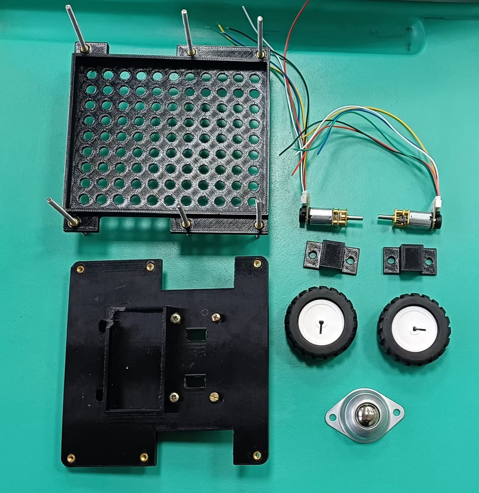
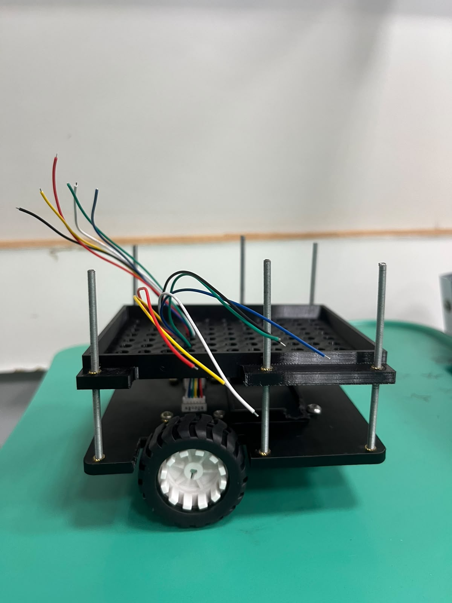
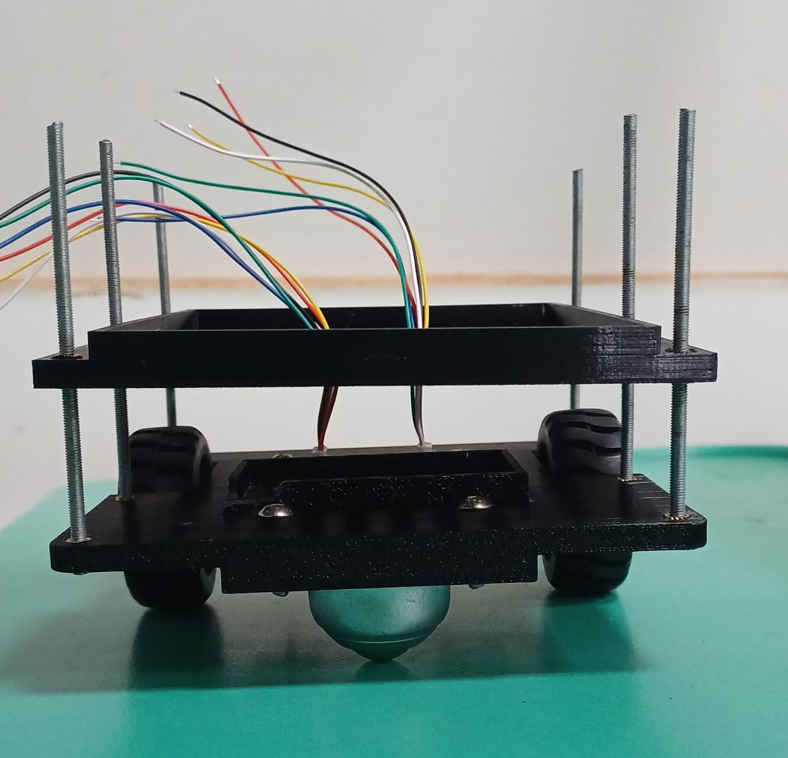
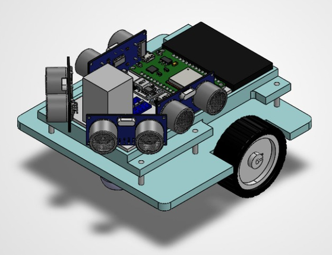
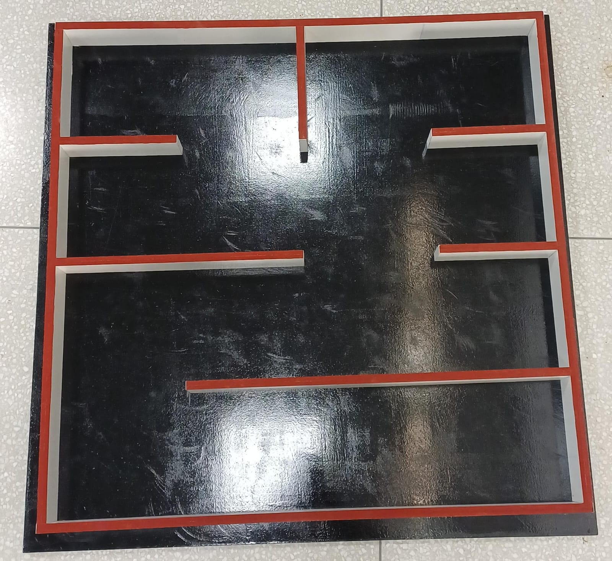
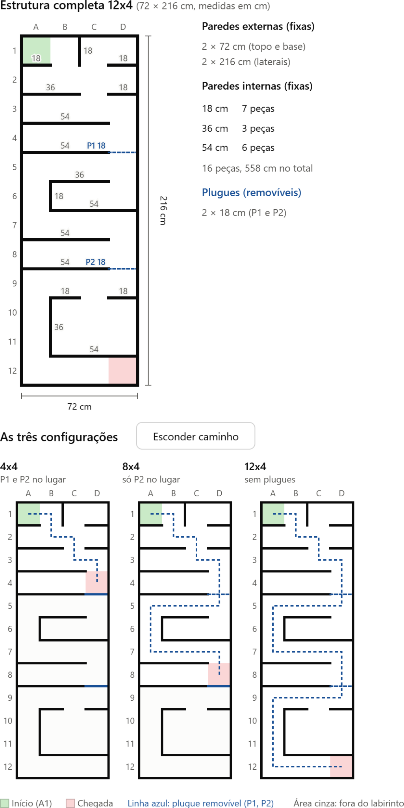

# Testes de Estrutura

Esta seção apresenta os ensaios e as metodologias de verificação e validação aplicados à parte estrutural do projeto, que compreende o **micromouse** e o **labirinto de teste**. O objetivo desta etapa é assegurar que as peças fabricadas e montadas reproduzam fielmente as premissas estabelecidas no [projeto conceitual de estruturas](4.1%20-%20Projeto%20conceitual%20de%20estruturas.md).

Para isso, são avaliados parâmetros de tolerância dimensional, estabilidade, rigidez a impactos e dinâmica de rolamento do sistema de locomoção, além da conformidade entre a montagem real e a modelagem virtual. Os resultados de cada ensaio estão consolidados na [Tabela de Testes](#3-tabela-de-testes).

## 1. Micromouse

### 1.1 Inventário Físico

Antes da montagem, todas as peças da estrutura (carcaça) do micromouse foram reunidas e conferidas com a lista definida no projeto conceitual. A Figura 1 apresenta as peças separadas.

<em>Figura 1: peças da estrutura do micromouse separadas.</em>

| **Peça** | **Quantidade** | **Material** |
|----------|:--------------:|--------------|
| Chassi | 1 | PETG (impressão 3D) |
| Suporte para os componentes de hardware | 1 | PETG (impressão 3D) |
| Suporte dos motores | 2 | PETG (impressão 3D) |
| Barra roscada de fixação | 6 | Aço |
| Micromotor N20 com encoder | 2 | Caixa de redução metálica |
| Roda | 2 | Borracha |
| Roda boba | 1 | Metal |

### 1.2 Montagem Estrutural

Após o inventário, executou-se a montagem mecânica do chassi para avaliar a rigidez do conjunto e o acoplamento entre as peças. As Figuras 2 e 3 mostram a carcaça do micromouse montada, com o posicionamento preliminar da fiação dos motores.

<em>Figura 2: estrutura do micromouse montada, vista lateral.</em>

<em>Figura 3: estrutura do micromouse montada, vista frontal.</em>

Para garantir a estabilidade mecânica do conjunto e reduzir vibrações que possam comprometer a leitura dos sensores, foram utilizados insertos metálicos incorporados às peças de PETG, nos quais são fixados elementos roscados. Essa solução mantém as peças firmemente unidas e, ao mesmo tempo, permite desmontar a estrutura, preservando o livre acesso aos componentes eletrônicos para manutenção.

### 1.3 Conformidade com o Modelo CAD

Para confirmar que a construção real não divergiu do projeto, o protótipo montado foi comparado ao modelo tridimensional desenvolvido em CAD (Figura 4). A comparação verificou se as furações, os suportes dos sensores e as folgas de acoplamento foram respeitados.

<em>Figura 4: micromouse montado virtualmente em CAD.</em>

## 2. Labirinto de Teste

O labirinto de teste permite validar o comportamento do micromouse em um ambiente semelhante ao da competição. Esta seção apresenta a estrutura construída e a sua comparação com a modelagem feita no projeto conceitual.

O material escolhido foi o MDF, por se assemelhar ao do labirinto oficial. Para atender ao regulamento da competição, o piso foi pintado de preto e o topo das paredes, de vermelho.

### 2.1 Inventário Físico

O labirinto construído é composto pelas seguintes peças:

| **Peça** | **Quantidade** | **Dimensões (comprimento x altura)** |
|----------|:--------------:|--------------------------------------|
| Piso | 1 | — |
| Parede externa | 4 | — x 5 cm |
| Parede interna | 3 | 16,5 x 5 cm |
| Parede interna | 1 | 17,7 x 5 cm |
| Parede interna | 1 | 34,2 x 5 cm |
| Parede interna | 1 | 51,9 x 5 cm |

Todas as paredes têm 5 cm de altura. Os comprimentos das paredes internas são menores que os múltiplos de 18 cm da modelagem (18, 36 e 54 cm) porque foi descontada a espessura das paredes onde elas se apoiam, mantendo as células com as dimensões previstas.

### 2.2 Montagem Estrutural e Conformidade com a Modelagem

Entre as três configurações previstas no projeto conceitual (4x4, 4x8 e 4x12), optou-se por construir a **configuração menor (4x4)**. Ela é suficiente para realizar todos os testes necessários com o micromouse e consome menos material. O labirinto foi montado conforme a configuração 4x4 da modelagem. A Figura 5 apresenta o labirinto montado e a Figura 6, a modelagem utilizada como referência.

<em>Figura 5: labirinto de teste montado (configuração 4x4).</em>

<em>Figura 6: modelagem do labirinto, com as medidas e as três configurações possíveis.</em>

## 3. Tabela de Testes

| **ID** | **Descrição** | **Data de Início** | **Data de Conclusão** | **Responsável** | **Resultados Esperados** | **Resultados Obtidos** | **Aprovação Interna (S/N)** | **Aprovação do Orientador (S/N)** | **Observações** |
|:------:|---------------|--------------------|-----------------------|-----------------|--------------------------|------------------------|:---------------------------:|:--------------------------------:|-----------------|
| 1.1 | Inventário físico das peças do micromouse | | | | Todas as peças previstas no projeto conceitual fabricadas ou adquiridas | Chassi, suporte de hardware, dois suportes de motor, barras roscadas, dois motores, duas rodas e roda boba conferidos e fotografados separadamente (Figura 1) | | | |
| 1.2 | Montagem mecânica do micromouse | | | | Peças montadas sem interferência, com fixação firme e acesso livre aos componentes eletrônicos | Estrutura montada com insertos no PETG e elementos de fixação roscados, mantendo o acesso para manutenção (Figuras 2 e 3) | | | |
| 1.3 | Comparação entre o micromouse montado e o modelo CAD | | | | Furações, suportes dos sensores e folgas de acoplamento iguais ao modelo CAD | Montagem real compatível com o modelo CAD (Figura 4) | | | |
| 1.4 | Conferência dimensional do chassi | | | | Chassi de 12 x 12 cm, com recortes laterais para as rodas e furos do motor/encoder conforme o desenho técnico | | | | |
| 1.5 | Conferência dimensional do suporte da protoboard | | | | Suporte conforme o desenho técnico, com colunas de elevação que não interferem na fixação da roda boba | | | | |
| 1.6 | Fixação da roda boba | | | | Roda boba de 48,3 x 32,1 x 20 mm fixada nos furos frontais de 4 mm, com 39,2 mm entre centros | | | | |
| 1.7 | Acoplamento dos motores N20 e das rodas | | | | Motores fixados abaixo do chassi e rodas encaixadas no eixo D de 3 mm, sem folga nem desalinhamento | | | | |
| 1.8 | Acomodação dos componentes eletrônicos | | | | ESP32-S3, ponte H, bateria LiPo, módulos step-down, conversor de nível, chave e sensores HC-SR04 acomodados nas posições previstas | | | | |
| 1.9 | Rigidez da estrutura e resistência a impactos | | | | Estrutura sem deformação visível nem soltura de peças com o peso dos componentes e sob pequenos impactos | | | | |
| 1.10 | Estabilidade e dinâmica de rolamento | | | | Robô nivelado nos três pontos de apoio, rolando em linha reta e realizando curvas sem travar | | | | |
| 1.11 | Inventário físico das peças do labirinto | | | | Piso, paredes externas e paredes internas em MDF, com 5 cm de altura | Piso, 4 paredes externas com 5 cm de altura e 6 paredes internas (3 de 16,5 cm, 1 de 17,7 cm, 1 de 34,2 cm e 1 de 51,9 cm, todas com 5 cm de altura) | | | |
| 1.12 | Montagem do labirinto 4x4 e comparação com a modelagem | | | | Labirinto montado conforme a configuração 4x4 da modelagem, com piso preto e topo das paredes vermelho | Labirinto 4x4 montado e pintado (Figura 5), conforme a modelagem (Figura 6) | | | Paredes internas mais curtas que os múltiplos de 18 cm devido ao desconto da espessura das paredes |
| 1.13 | Validação do caminho do labirinto | | | | Existe ao menos um caminho possível da célula A1 até a célula de chegada | | | | |
| 1.14 | Movimentação do micromouse dentro do labirinto | | | | Micromouse percorre os corredores e realiza curvas de 90° e 180° dentro de uma célula sem tocar as paredes | | | | |
