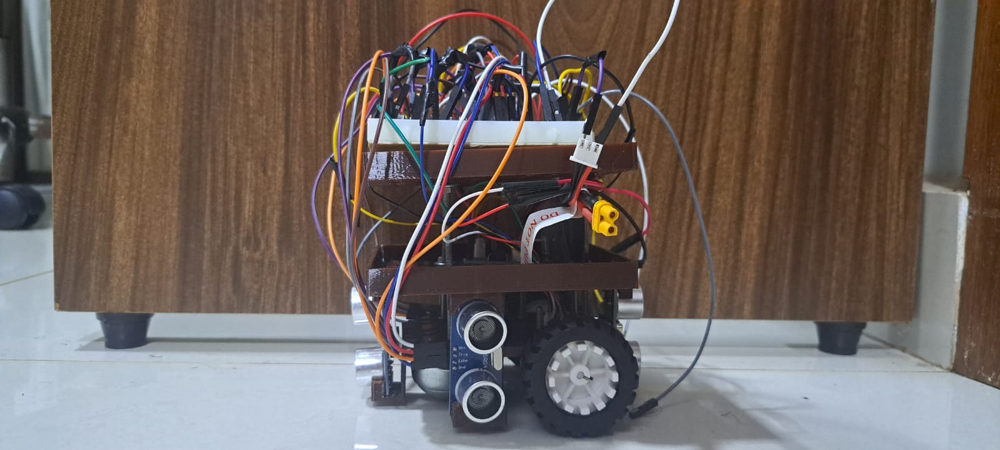
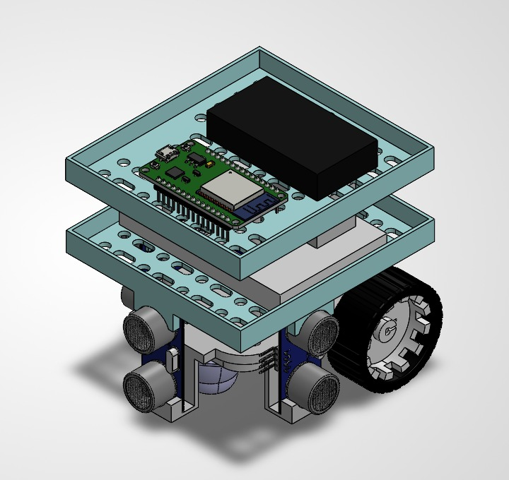
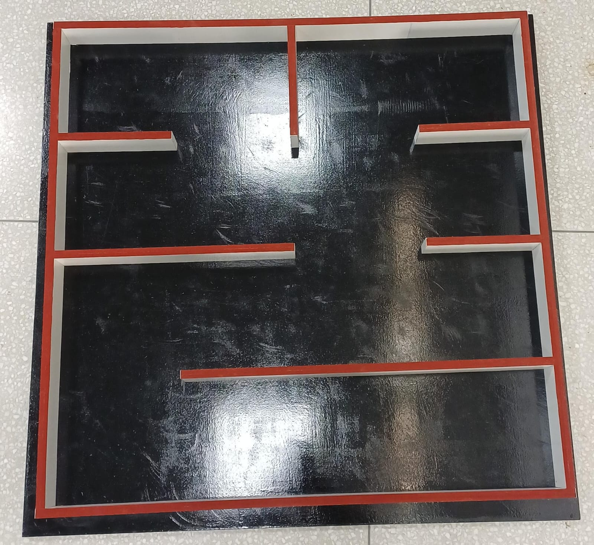
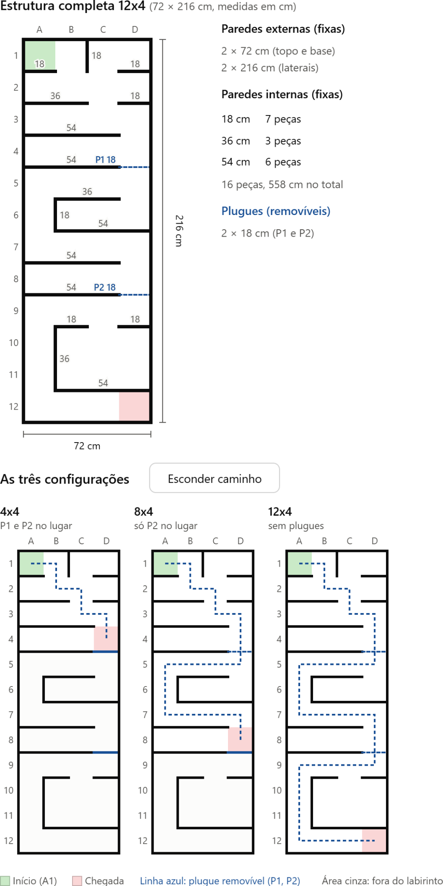

# Testes de Integração

## 1. Estruturas

Esta seção apresenta os ensaios e as metodologias de verificação e validação aplicados à parte estrutural do projeto, que compreende o **micromouse** e o **labirinto de teste**. O objetivo desta etapa é assegurar que as peças fabricadas e montadas reproduzam fielmente as premissas estabelecidas no [projeto conceitual de estruturas](4.1%20-%20Projeto%20conceitual%20de%20estruturas.md).

Para isso, são avaliados parâmetros de tolerância dimensional, estabilidade, rigidez a impactos e dinâmica de rolamento do sistema de locomoção, além da conformidade entre a montagem real e a modelagem virtual. Os resultados de cada ensaio estão consolidados na [Tabela de Testes](#13-tabela-de-testes).

Este documento apresenta a **segunda versão da estrutura** do micromouse, elaborada após a identificação de problemas na primeira versão, descritos na seção a seguir.

### Revisão da Estrutura

A primeira versão da estrutura (chassi de 12 x 12 cm) foi montada e testada, mas apresentou dois problemas:

- **Dimensões excessivas:** o chassi era maior do que o requisito do projeto, e o raio de giro em torno do eixo do motor ficou maior do que o previsto.
- **Posicionamento inadequado dos sensores:** os sensores HC-SR04 não ficaram nas posições previstas pela modelagem, o que impossibilitou o uso adequado do componente (reprovação do teste 1.8 da primeira versão).

Por esse motivo, foi desenvolvido um **novo CAD** e uma **nova estrutura**, com chassi de **7 x 8 cm**, encaixe lateral para os sensores e novo suporte para os componentes eletrônicos. Os testes a seguir foram refeitos para essa versão.

  
  

<em>Figura 1: comparação entre a primeira versão (12 x 12 cm, à esquerda) e a segunda versão (7 x 8 cm, à direita) da estrutura.</em>

### 1.1 Micromouse

#### 1.1.1 Inventário Físico

Antes da montagem, todas as peças da estrutura (carcaça) do micromouse foram reunidas e conferidas com a lista definida no projeto conceitual. A Figura 2 apresenta as peças separadas.

<em>Figura 2: peças da estrutura do micromouse separadas.</em>

> **[ADICIONAR FOTO]** Peças da nova estrutura separadas (a foto `testes_estrutura_pecas_separadas.jpg` mostra o chassi antigo).

| **Peça** | **Quantidade** | **Material** |
|----------|:--------------:|--------------|
| Chassi | 1 | PETG (impressão 3D) |
| Suporte para os componentes de hardware | 1 | PETG (impressão 3D) |
| Suporte dos motores | 2 | PETG (impressão 3D) |
| Barra roscada de fixação | 6 | Aço |
| Micromotor N20 com encoder | 2 | Caixa de redução metálica |
| Roda | 2 | Borracha |
| Roda boba | 1 | Metal |

#### 1.1.2 Montagem Estrutural

Após o inventário, executou-se a montagem mecânica do chassi para avaliar a rigidez do conjunto e o acoplamento entre as peças. As Figuras 3 e 4 mostram a carcaça do micromouse montada, com o posicionamento preliminar da fiação dos motores.

<em>Figura 3: estrutura do micromouse montada, vista lateral.</em>

<em>Figura 4: estrutura do micromouse montada, vista frontal.</em>

Para garantir a estabilidade mecânica do conjunto e reduzir vibrações que possam comprometer a leitura dos sensores, foram utilizados insertos metálicos incorporados às peças de PETG, nos quais são fixados elementos roscados. Essa solução mantém as peças firmemente unidas e, ao mesmo tempo, permite desmontar a estrutura, preservando o livre acesso aos componentes eletrônicos para manutenção.

#### 1.1.3 Conformidade com o Modelo CAD

Para confirmar que a construção real não divergiu do projeto, o protótipo montado foi comparado ao novo modelo tridimensional desenvolvido em CAD (Figura 5). A comparação verificou se as furações, os suportes dos sensores e as folgas de acoplamento foram respeitados. Nessa versão, o CAD foi alterado para ajuste dos componentes, como os sensores, e foram realizados novos furos.

  
  

<em>Figura 5: micromouse montado virtualmente em CAD (nova versão).</em>

### 1.2 Labirinto de Teste

O labirinto de teste permite validar o comportamento do micromouse em um ambiente semelhante ao da competição. Esta seção apresenta a estrutura construída e a sua comparação com a modelagem feita no projeto conceitual.

O material escolhido foi o MDF, por se assemelhar ao do labirinto oficial. Para atender ao regulamento da competição, o piso foi pintado de preto e o topo das paredes, de vermelho.

#### 1.2.1 Inventário Físico

O labirinto construído é composto pelas seguintes peças:

| **Peça** | **Quantidade** | **Dimensões (comprimento x altura)** |
|----------|:--------------:|--------------------------------------|
| Piso | 1 | — |
| Parede externa | 4 | — x 5 cm |
| Parede interna | 3 | 16,5 x 5 cm |
| Parede interna | 1 | 17,7 x 5 cm |
| Parede interna | 1 | 34,2 x 5 cm |
| Parede interna | 1 | 51,9 x 5 cm |

Todas as paredes têm 5 cm de altura. Os comprimentos das paredes internas são menores que os múltiplos de 18 cm da modelagem (18, 36 e 54 cm) porque foi descontada a espessura das paredes onde elas se apoiam, mantendo as células com as dimensões previstas.

#### 1.2.2 Montagem Estrutural e Conformidade com a Modelagem

Entre as três configurações previstas no projeto conceitual (4x4, 4x8 e 4x12), optou-se por construir a **configuração menor (4x4)**. Ela é suficiente para realizar todos os testes necessários com o micromouse e consome menos material. O labirinto foi montado conforme a configuração 4x4 da modelagem. A Figura 6 apresenta o labirinto montado e a Figura 7, a modelagem utilizada como referência.

<em>Figura 6: labirinto de teste montado (configuração 4x4).</em>

<em>Figura 7: modelagem do labirinto, com as medidas e as três configurações possíveis.</em>

### 1.3 Tabela de Testes

| ID | Descrição | Data de Início | Data de Conclusão | Responsável | Resultados Esperados | Resultados Obtidos | Aprovação Interna (S/N) | Aprovação do Orientador (S/N) | Observações |
|:--:|---|---|---|---|---|---|:--:|:--:|---|
| 1.1 | Inventário físico das peças do micromouse | 07/10/26 | 23/11/26 | Líder de estruturas | Verificação da fabricação e peças adquiridas em acordo com o previsto no projeto conceitual | Chassi, suporte de hardware, dois suportes de motor, barras roscadas, dois motores, duas rodas e roda boba conferidos separadamente e integrados | Sim | Sim | Todos os componentes adquiridos e fabricados vieram em perfeita condição |
| 1.2 | Montagem micromouse | 07/10/26 | 23/11/26 | Todos os membros de estruturas | Peças montadas sem interferência, com fixação firme e acesso livre aos componentes eletrônicos | Estrutura montada com insertos no PETG e elementos de fixação roscados, mantendo o acesso para manutenção | Sim | Sim | Não houve problemas na montagem |
| 1.3 | Comparação entre o micromouse montado e o modelo CAD | 07/10/26 | 23/11/26 | Todos os membros de estruturas | Furações, suportes dos sensores e folgas de acoplamento iguais ao modelo CAD | Montagem real compatível com o modelo CAD | Sim | Sim | Houve alteração no CAD para ajuste de componentes, como o sensor, e realização de novos furos |
| 1.4 | Conferência dimensional do chassi | 21/10/26 | 23/11/26 | Líder de estruturas | Chassi de 7 x 8 cm, com encaixe lateral para os sensores, recortes laterais para as rodas e furos do motor/encoder conforme o novo CAD | Chassi com 7 x 8 cm. Encaixe para os sensores condizente com o novo CAD | Sim | Sim | Foi necessário um novo CAD da estrutura para o acoplamento dos sensores |
| 1.5 | Conferência dimensional do suporte da protoboard | 07/10/26 | 23/11/26 | Líder de estruturas | Suporte conforme a modelagem, com colunas de elevação | Condizente com a modelagem | Sim | Sim | Não houve problema de modelagem do suporte para os componentes eletrônicos |
| 1.6 | Fixação da roda boba | 07/10/26 | 23/11/26 | Líder de estruturas | Roda boba de 48,3 x 32,1 x 20 mm fixada nos furos frontais de 4 mm, com 39,2 mm entre centros | Condizente com o desenho inicial. No novo CAD, o furo para a roda boba não foi realizado | Sim | Sim | Para a fixação da roda boba foi utilizada fita dupla face |
| 1.7 | Acoplamento dos motores N20 e das rodas | 07/10/26 | 23/11/26 | Líder de estruturas | Motores fixados abaixo do chassi e rodas encaixadas no eixo D de 3 mm, sem folga nem desalinhamento | Motores abaixo do chassi devidamente fixados e rodas encaixadas nos eixos | Sim | Sim | Nenhum problema de fixação dos motores e encaixe das rodas |
| 1.8 | Acomodação dos componentes eletrônicos | 26/10/26 | 23/11/26 | Líder de estruturas e hardware | ESP32-S3, ponte H, bateria LiPo, módulos step-down, conversor de nível, chave e sensores HC-SR04 acomodados nas posições previstas | Todos os componentes eletrônicos ficaram devidamente alocados nos suportes | Sim | Sim | Nenhum problema de integração da estrutura com o novo suporte. Na primeira versão, os sensores não ficaram nas posições previstas, o que motivou a revisão da estrutura |
| 1.9 | Inventário físico das peças do labirinto | 14/10/26 | 14/10/26 | Todos os membros de estruturas | Piso, paredes externas e paredes internas em MDF, com 5 cm de altura | Piso, 4 paredes externas com 5 cm de altura e 6 paredes internas (3 de 16,5 cm, 1 de 17,7 cm, 1 de 34,2 cm e 1 de 51,9 cm, todas com 5 cm de altura) | Sim | Sim | Todas as peças em conformidade com a modelagem |
| 1.10 | Montagem do labirinto 4x4 e comparação com a modelagem | 26/10/26 | 26/10/26 | Todos os membros de estruturas | Labirinto montado conforme a configuração 4x4 da modelagem, com piso preto e topo das paredes vermelho | Labirinto 4x4 montado e pintado conforme a modelagem | Sim | Sim | Montagem do labirinto condizente com os requisitos do projeto |
